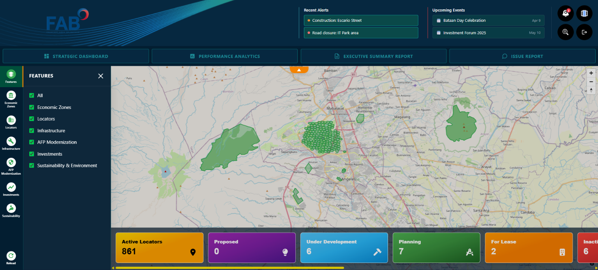
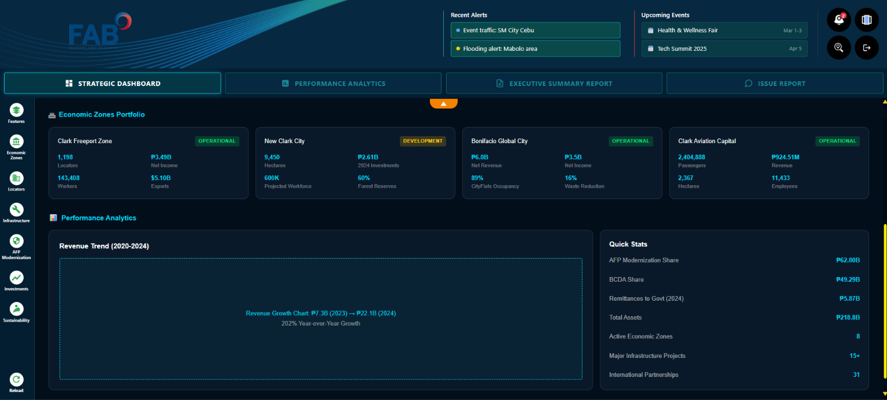
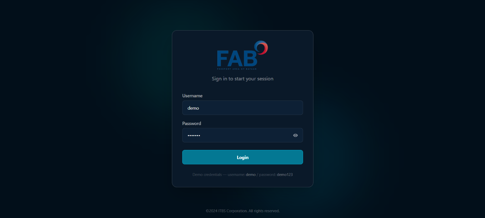

# FAB Dashboard

A geospatial dashboard for **BCDA (Bases Conversion and Development Authority)**, built as a frontend project with Vue 3, MapLibre GL and Tailwind CSS.

**Live demo:** [fab-dashboard-drab.vercel.app](https://fab-dashboard-drab.vercel.app)
**Demo login:** username `demo` · password `demo123`



## Features

- 🗺️ Interactive GIS map built with MapLibre GL, with site markers and area boundaries
- 🗂️ Six toggleable layers: Economic Zones, Locators, Infrastructure, AFP Modernization, Investments, and Sustainability & Environment
- 📊 Strategic Dashboard, Performance Analytics, Executive Summary and Issue Report views
- 🔍 Site search with search history
- 📍 Navigation sites and status summary cards (active locators, proposed, under development, planning, for lease)
- 🔐 Demo login with route protection

## Screenshots

| Dashboard                           | Login                      |
| ----------------------------------- | -------------------------- |
|  |  |

## Built with

- [Vue 3](https://vuejs.org/) and Vue Router
- [Vite](https://vitejs.dev/)
- [MapLibre GL JS](https://maplibre.org/)
- [Tailwind CSS](https://tailwindcss.com/)
- Chart.js (through vue-chartjs)
- Hosted on Vercel

## Getting started

```bash
git clone https://github.com/InterfaceAlchemist/FAB-Dashboard.git
cd FAB-Dashboard
npm install
npm run dev
```

Open `http://localhost:5173` in your browser and sign in with the demo credentials above.

Build for production:

```bash
npm run build
npm run preview
```

## About the data

This is a proof of concept. By default the app runs entirely on the sample data in `data/navigationSites/mapSites.js`, so it needs no backend or API key.

To point it at a live API instead, add these to a local `.env` file (never commit this file):

```
VITE_USE_API=true
VITE_API_TOKEN=your-token
```

## Project structure

```
src/
  views/            Login and Dashboard pages
  components/       Header, side navigation, map, content panel, search, reports
  services/         sitesData.js — chooses sample data or the API
  router.js         routes and login guard
data/               sample site data
docs/               README screenshots
```

## Notes

Built as a frontend project for demonstration. Map tiles are provided by OpenStreetMap contributors.
